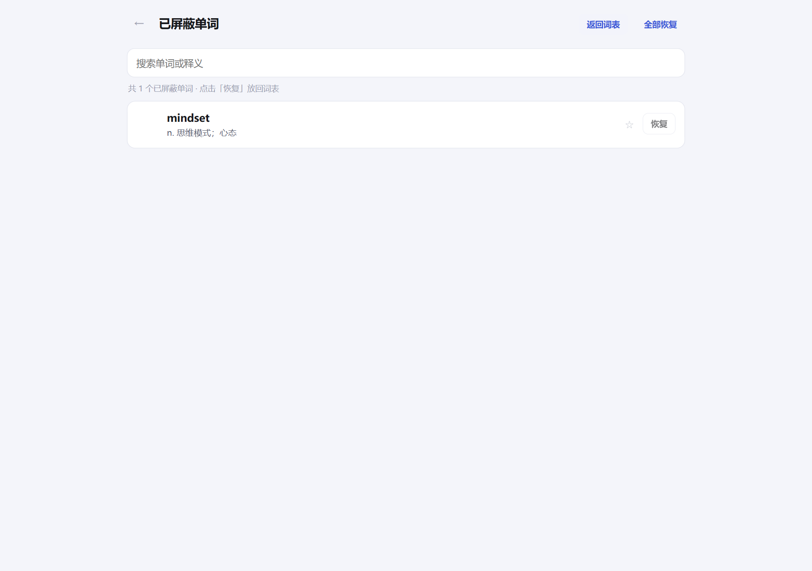

# 单词练习 · Web 版

[Android 版 WordDrill](https://github.com/SpeakerC/worddrill) 的桌面浏览器移植：界面基本沿用，针对电脑做了适配
（宽屏两栏、鼠标悬停反馈、键盘 `1`–`4` / `A`–`D` / `Enter`）。

纯本地运行，不联网、无广告，词库和练习记录都存在本机的 JSON 文件里。

```bash
git clone https://github.com/SpeakerC/worddrill-web.git
```

## 快速开始

需要 Node.js 18+（双击启动脚本前确认 `node -v` 能输出版本号）。

| 方式 | 操作 |
|---|---|
| 正常启动 | 双击 **`启动.bat`**，会自动开服务并打开浏览器 |
| 放桌面 | 双击 **`创建桌面快捷方式.vbs`**，桌面会多一个「单词练习」 |
| 后台无窗口 | 双击 **`启动（无窗口）.vbs`** |
| 停止 | 双击 **`停止.bat`**，或启动窗口里按 `Ctrl+C` |

默认地址 <http://127.0.0.1:3120/>，端口被占用时会自动往后找一个。
命令行启动：`node server.js`（等价于 `npm start`）。

## 截图

| 首页 | 练习 |
|---|---|
|  |  |

| 默写反馈 | 结果 |
|---|---|
|  |  |

| 词表 | 已屏蔽 |
|---|---|
|  |  |

| 导入 | 关于 |
|---|---|
|  |  |

## 功能

- **三种模式**：英译汉（看词选义）、汉译英（看义选词）、单词默写（看义拼写，带首字母与字母数提示）。
- **抽题设置**：每轮 1–200 题，可按词库索引区间抽题，可开关「允许重复抽到已练过的词」。
- **内置词库**：高中 3500 词，3793 条，含词性与释义。
- **自组词库**：把 Markdown / 文本文件拖进导入页，或直接粘贴表格；自动识别 UTF-8 / GBK，
  序号列会被忽略，重复单词跳过，导入后还能继续追加。
- **屏蔽单词**：词表行尾「屏蔽」，被屏蔽的词不参与抽题、错题，剩余单词索引自动重排；
  「已屏蔽（N）」里点「恢复」放回原位置，也可「全部恢复」。
- **星标与错题**：练习页、词表都能加星标；答错自动进错题本，答对自动移出；支持只练星标、重练错题。
- **练习进度**：首页显示当前词库的已练 / 总数与进度条。

## 键盘

| 按键 | 作用 |
|---|---|
| `1`–`4` / `A`–`D` | 选择选项 |
| `Enter` | 提交拼写 / 下一题 |
| `Esc` | 关闭弹窗 |

## 数据

- 首次启动会生成 `data/db.json`，并把内置 3500 词写进去。
- 想恢复初始状态：关掉服务，删掉 `data` 目录再启动。
- 备份/迁移：直接复制 `db.json`。
- 也可以用环境变量 `WORDDRILL_DATA` 指定数据目录。
- 服务只监听 `127.0.0.1`，局域网里的其他设备访问不到。

## 技术

- 后端：Node.js 内置 `http` / `fs`，**零运行时依赖**；数据存 JSON，接口是 `/api/*`。
- 前端：原生 HTML / CSS / JS，无构建步骤，改完刷新即可。
- 测试：`node --test`（13 个单元测试：出题、解析、存储）。

```bash
node --test                 # 单元测试
node scripts/ui-smoke.js    # jsdom 跑一遍完整流程（首页/练习/默写/屏蔽/导入/关于）
```

`scripts/screenshots.js` 用本机 Edge 无头模式重新生成 `docs/screenshots/`，
需要先 `npm install`（只装 jsdom 和 playwright-core 两个开发依赖）。

## 与 Android 版的差异

- 数据用 JSON 文件而不是 SQLite，方便直接备份、迁移。
- 练习页改成手动「下一题（Enter）」，桌面端更顺手（Android 是答对后自动跳）。
- 屏蔽从长按改成行尾按钮，鼠标更好点。
- 「关于」页内容同样由 `assets/about.txt` 驱动。

## 协议

[MIT](LICENSE)。内置词库来自 [pluto0x0/word3500](https://github.com/pluto0x0/word3500)（MIT）。
