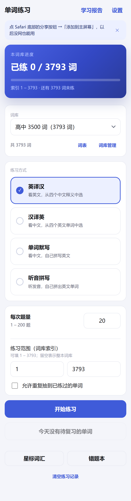
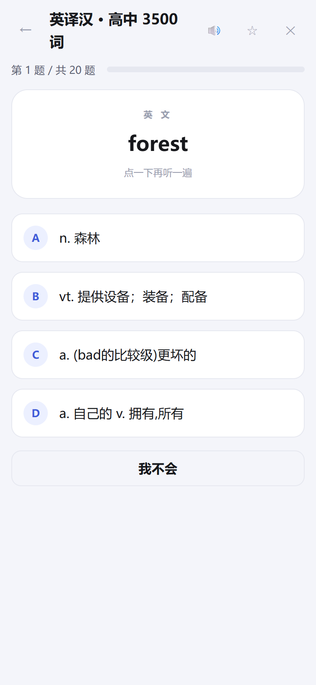
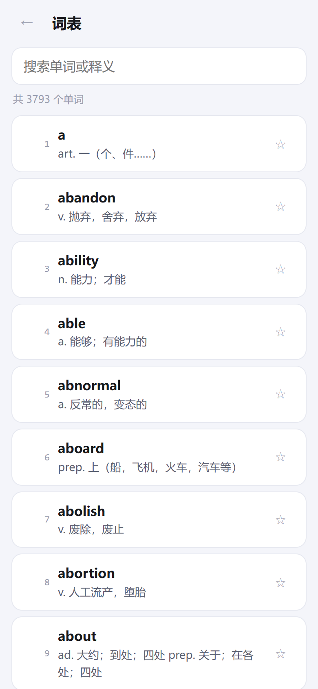
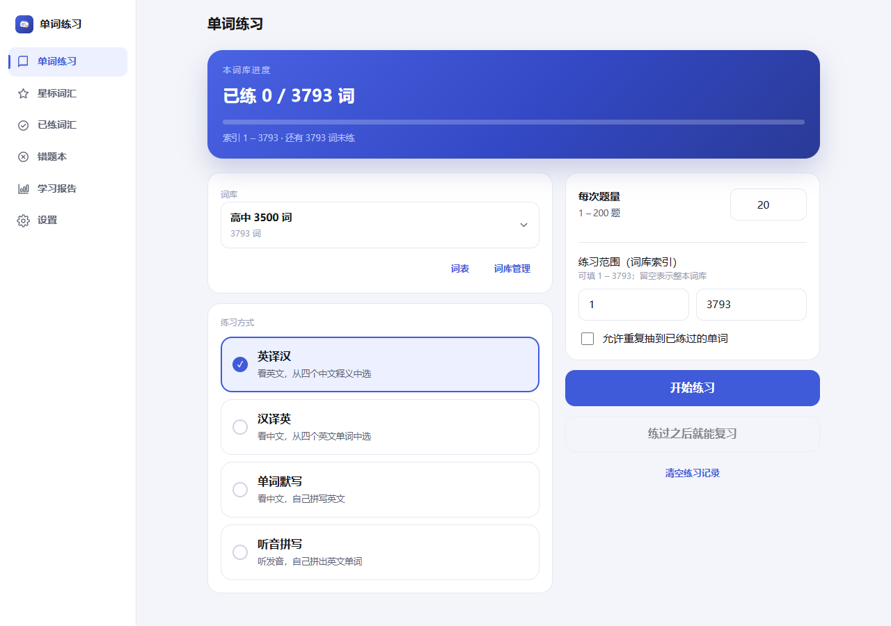
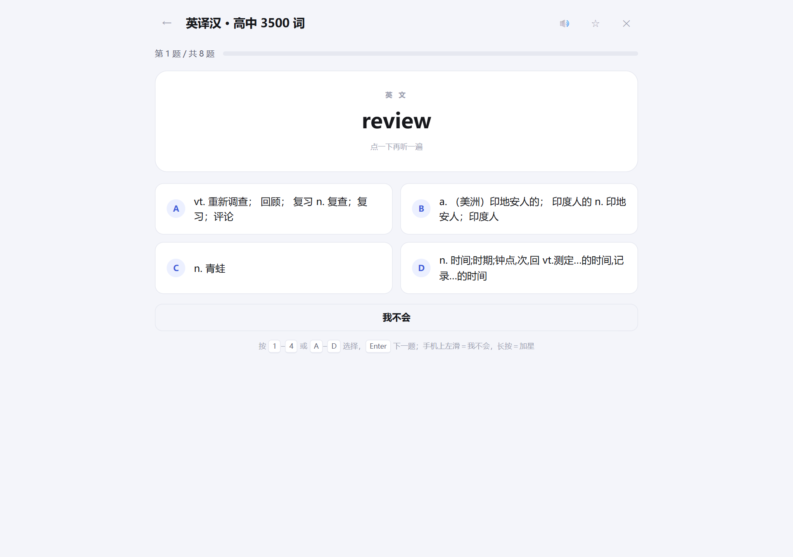
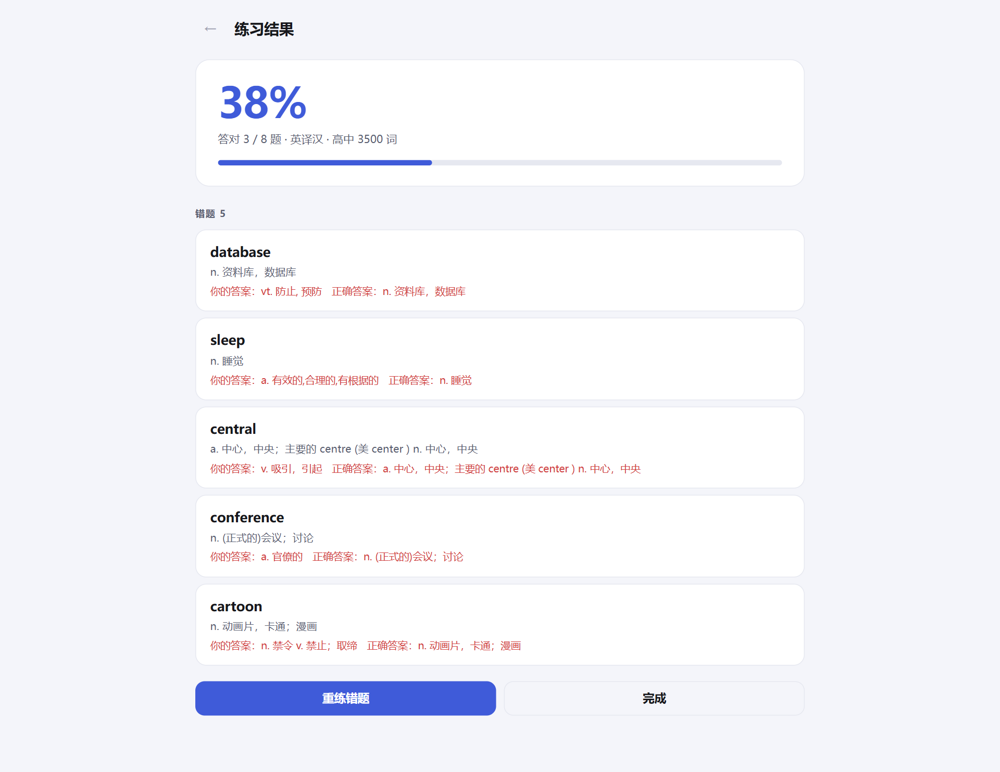
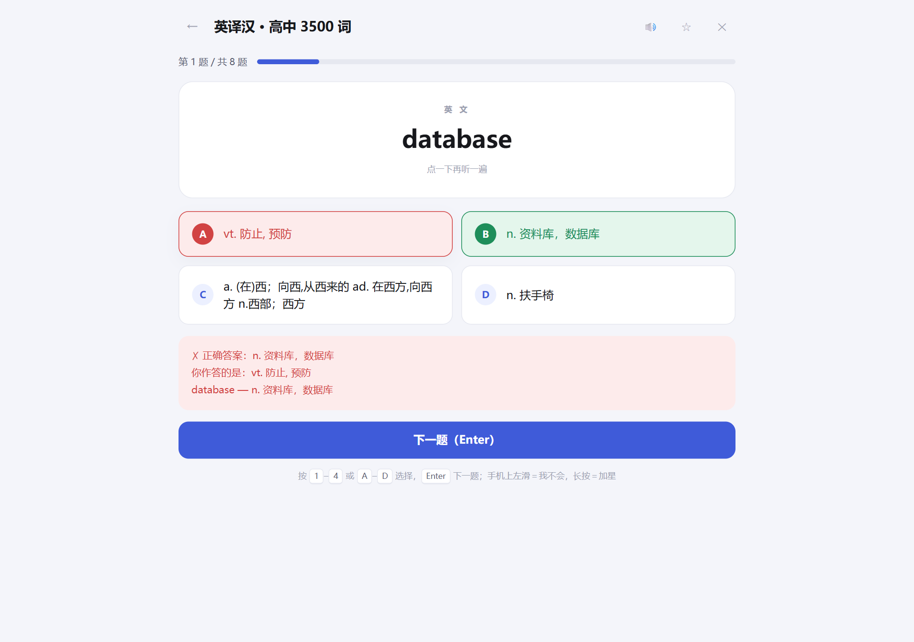
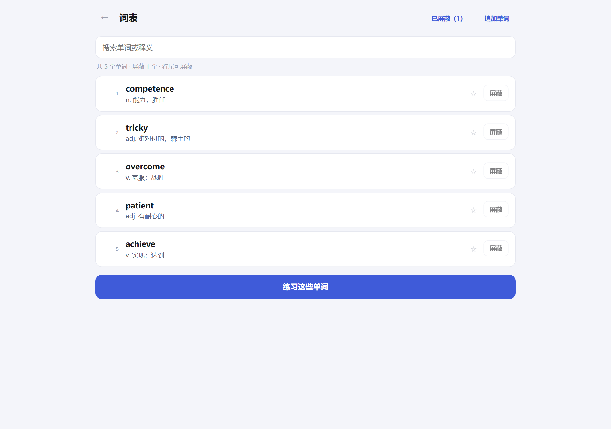
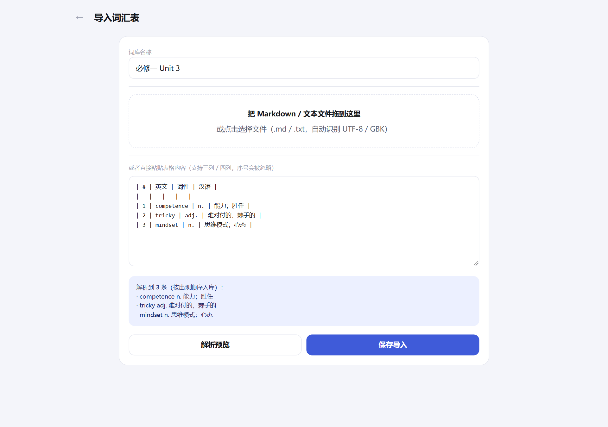
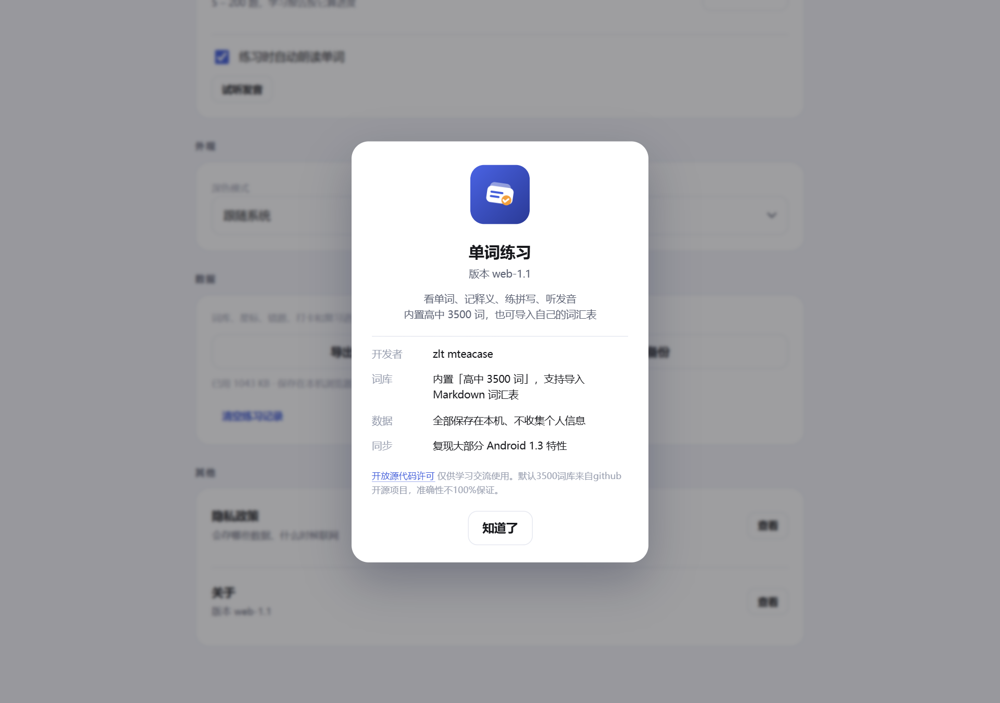

# 单词练习

[Android 版 WordDrill](https://github.com/SpeakerC/worddrill) 的网页移植：英译汉 / 汉译英 / 单词默写，
内置高中 3500 词，也能导入自己的词汇表。

纯静态页面，可以安装到手机或电脑桌面，**断网也能用**；所有数据保存在这台设备的浏览器里，不联网、不上传。

**在线使用：<https://wordrill.zzlltt.xyz/>**

## 装到设备上

| 设备 | 做法 |
|---|---|
| iPhone / iPad | Safari 打开上面的网址 → 底部「分享」→「添加到主屏幕」 |
| Android | Chrome 打开网址 → 底部/菜单里的「安装应用」 |
| 电脑 | Edge / Chrome 打开网址 → 地址栏右侧的安装图标 |

装好之后图标就在桌面上，点开和普通 App 一样（全屏、没有地址栏），第一次打开过的内容会被缓存，之后没网也能练。

## 本地运行

需要 Node.js 18+，只是为了在本机预览和调试；正式使用不需要它。

```bash
git clone https://github.com/SpeakerC/worddrill-web.git
cd worddrill-web
```

| 方式 | 操作 |
|---|---|
| 正常启动 | 双击 **`启动.bat`**，自动开浏览器 |
| 放桌面 | 双击 **`创建桌面快捷方式.vbs`** |
| 后台无窗口 | 双击 **`启动（无窗口）.vbs`** |
| 停止 | 双击 **`停止.bat`**，或窗口里按 `Ctrl+C` |

默认地址 <http://127.0.0.1:3120/>，端口被占用会自动往后找。
想用手机连电脑预览：`node server.js --lan`，会打印同一 Wi-Fi 下的地址。

## 截图

| 手机 · 首页 | 手机 · 练习 | 手机 · 词表 |
|---|---|---|
|  |  |  |

| 桌面 · 首页 | 练习 | 结果 |
|---|---|---|
|  |  |  |

| 默写反馈 | 词表 | 导入 | 关于 |
|---|---|---|---|
|  |  |  |  |

## 功能

- **三种模式**：英译汉（看词选义）、汉译英（看义选词）、单词默写（看义拼写，带首字母与字母数提示）。
- **抽题设置**：每轮 1–200 题，可按词库索引区间抽题，可开关「允许重复抽到已练过的词」。
- **内置词库**：高中 3500 词，3793 条，含词性与释义。
- **自组词库**：把 Markdown / 文本文件拖进导入页，或直接粘贴表格；自动识别 UTF-8 / GBK，
  序号列会被忽略，重复单词跳过，导入后还能继续追加。
- **屏蔽单词**：词表行尾「屏蔽」，被屏蔽的词不参与抽题、错题，剩余单词索引自动重排；
  「已屏蔽（N）」里点「恢复」放回原位置，也可「全部恢复」。
- **星标与错题**：练习页、词表都能加星标；答错自动进错题本，答对自动移出；支持只练星标、重练错题。
- **练习进度**：首页显示当前词库的已练 / 总数与进度条。
- **离线可用**：Service Worker 缓存页面与词表，装到桌面后断网照常打开。

## 键盘

| 按键 | 作用 |
|---|---|
| `1`–`4` / `A`–`D` | 选择选项 |
| `Enter` | 提交拼写 / 下一题 |
| `Esc` | 关闭弹窗 |

## 数据

- 单词、星标、错题、练习记录都存在浏览器的本地存储里（localStorage），按词库分开存放。
- **备份**：首页 → 词库管理 → 「导出备份」，会下载一个 JSON 文件。
- **恢复**：同一处的「恢复备份」，选那个 JSON 文件即可（会覆盖当前数据）。
- 换手机、清理浏览器数据之前先导出一份；清掉浏览器站点数据等于恢复出厂。
- 早期服务器版的 `data/db.json` 也是同样的结构，可以直接当备份文件恢复。

## 技术

- 前端：原生 HTML / CSS / JS，ES 模块，无框架、无构建步骤，零运行时依赖。
- 离线：`manifest.webmanifest` + `public/sw.js`；`server.js` 只是一个本地静态服务器（几十行，零依赖）。
- 测试：`node --test`（20 个单元测试：出题、解析、存储、持久化、备份）。

```bash
node --test                 # 单元测试
node scripts/ui-smoke.js    # 真浏览器跑完整流程（含刷新后数据还在、断网可用）
node scripts/screenshots.js # 用本机 Edge 无头模式重新生成截图
```

后两个脚本需要 `npm install`（只装 playwright-core 一个开发依赖，用本机已装的 Edge）。

## 与 Android 版的差异

- 数据存在浏览器里，不用 SQLite 文件；换设备靠「导出 / 恢复备份」。
- 练习页改成手动「下一题（Enter）」，桌面端更顺手（Android 是答对后自动跳）。
- 屏蔽从长按改成行尾按钮，鼠标更好点。
- 词表一次渲染 200 条，手机长列表不卡，「显示更多」继续往下翻。

## 协议

[MIT](LICENSE)。内置词库来自 [pluto0x0/word3500](https://github.com/pluto0x0/word3500)（MIT）。
