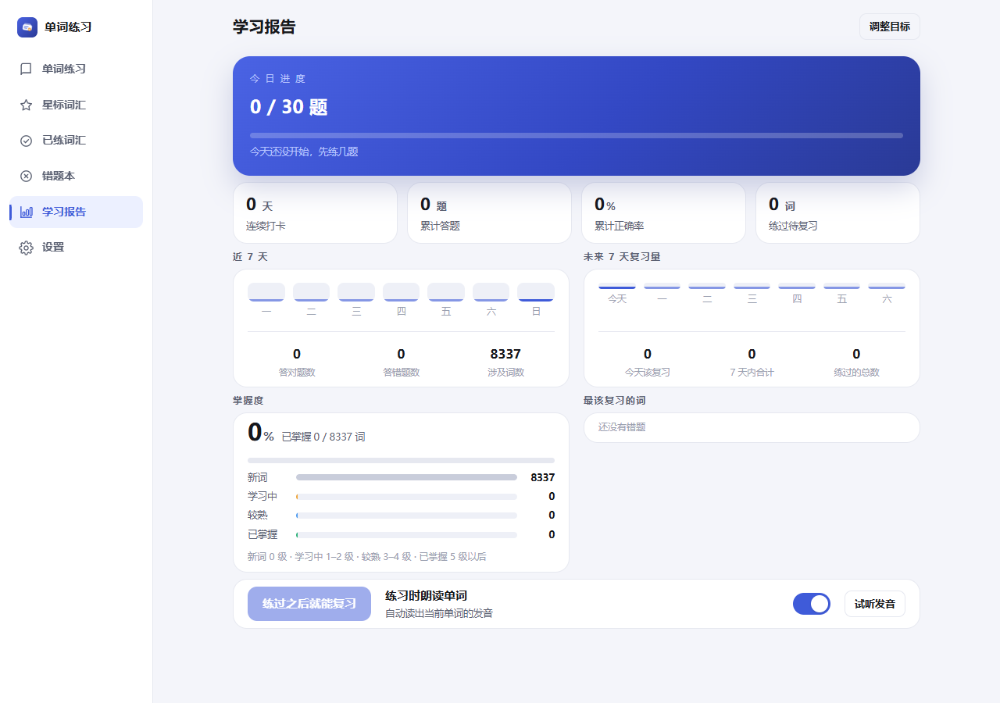
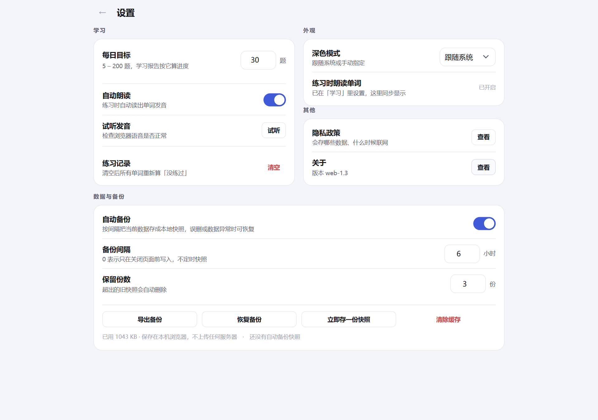
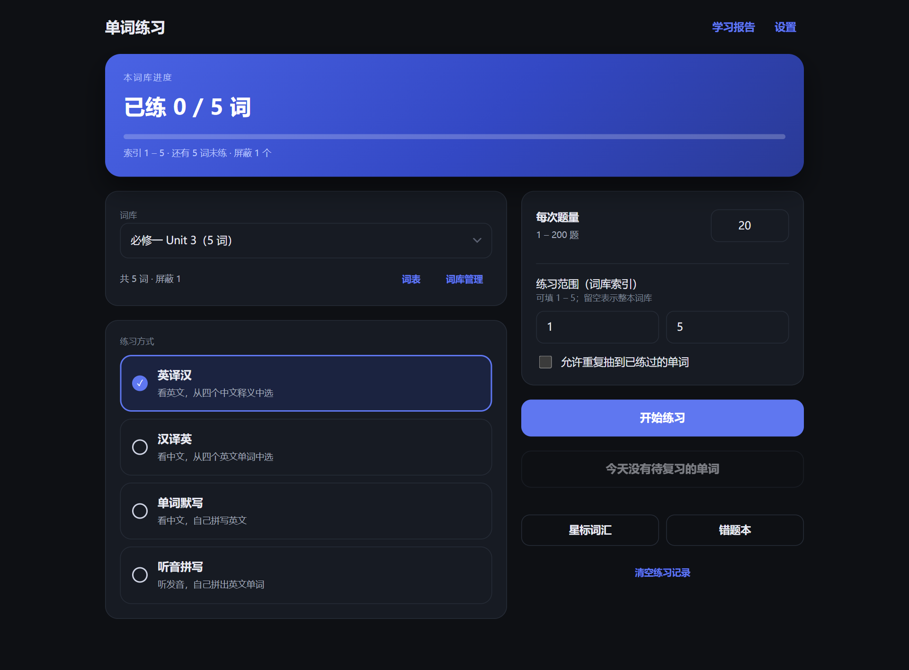

# 单词练习

[Android 版 WordDrill](https://github.com/SpeakerC/worddrill) 的网页移植：英译汉 / 汉译英 / 单词默写 / 听音拼写，
内置高中 3500 词与大学英语四级两本词库，也能导入自己的词汇表。

纯静态页面，可以安装到手机或电脑桌面，**断网也能用**；所有数据保存在这台设备的浏览器里，不联网、不上传。

**在线使用：<https://wordrill.zzlltt.xyz/>**

当前为 **web-2.0**：桌面端左侧导航、星标 / 已练 / 错题三个独立入口、太阳月亮主题开关；
新练习只抽没练过的词，首练时可直接把词标成「已掌握」。

## 装到设备上

| 设备 | 做法 |
|---|---|
| iPhone / iPad | Safari 打开上面的网址 → 底部「分享」→「添加到主屏幕」 |
| Android | Chrome 打开网址 → 底部/菜单里的「安装应用」 |
| 电脑 | Edge / Chrome 打开网址 → 地址栏右侧的安装图标 |

装好之后图标就在桌面上，点开和普通 App 一样（全屏、没有地址栏），第一次打开过的内容会被缓存，之后没网也能练。

iPhone / iPad 也可以改用描述文件一键添加：[最新 iOS 描述文件](https://github.com/SpeakerC/worddrill-web/releases/latest)。
下载后用 Safari 允许，再到「设置 → 已下载描述文件」安装即可。描述文件里只有一个主屏幕书签，
不含任何 App 代码、不申请任何权限。

## 本地运行

需要 Node.js 18+，只是为了在本机预览和调试；正式使用不需要它。

```bash
git clone https://github.com/SpeakerC/worddrill-web.git
cd worddrill-web
```

| 方式 | 操作 |
|---|---|
| 正常启动 | 双击 **`启动.bat`**，自动开浏览器 |
| 放桌面 | 双击 **`创建桌面快捷方式.vbs`** |
| 后台无窗口 | 双击 **`启动（无窗口）.vbs`** |
| 停止 | 双击 **`停止.bat`**，或窗口里按 `Ctrl+C` |

默认地址 <http://127.0.0.1:3120/>，端口被占用会自动往后找。
想用手机连电脑预览：`node server.js --lan`，会打印同一 Wi-Fi 下的地址。

## 截图

> **以下截图为旧版界面**（web-1.x，无左侧导航栏、首页仍带三个入口按钮），
> 新版界面请直接打开在线地址查看。

| 手机 · 首页 | 手机 · 练习 | 手机 · 词表 |
|---|---|---|
|  |  |  |

| 桌面 · 首页 | 练习 | 结果 |
|---|---|---|
|  |  |  |

| 默写反馈 | 词表 | 导入 | 关于 |
|---|---|---|---|
|  |  |  |  |

| 学习报告 | 设置 | 深色模式 |
|---|---|---|
|  |  |  |

## 功能

- **四种模式**：英译汉（看词选义）、汉译英（看义选词）、单词默写（看义拼写，带首字母与字母数提示）、
  听音拼写（听发音写单词，题面不显示中文）。
- **朗读**：英译汉和听音拼写会自动读词，题面点一下可重听；练习页右上角喇叭随时重播，
  设置里可整体关掉。用的是浏览器自带的语音合成，**离线可用**。
- **我不会**：不会就点「我不会」，直接记为答错并揭晓答案；手机上左滑等于「我不会」，长按加星。
- **间隔重复复习**：每答一题自动排下次复习时间（1 → 2 → 4 → 7 → 15 → 30 → 60 天），
  答错归零、第二天再来；首页显示今日到期数量，一键复习。
- **学习报告**：今日进度与每日目标、连续打卡、累计正确率、近 7 天柱状图、
  掌握度（新词 / 学习中 / 已掌握）和最该复习的 8 个错词。
- **深色模式**：设置页标题右边的太阳 / 月亮开关，一点就切换。
- **抽题设置**：每轮 1–200 题，可按词库索引区间抽题；新练习只抽**从没练过**的词，
  练过的词统一走「复习」，不会重复抽到。
- **首练标已掌握**：第一次见到的词若本来就会，点练习页红字「不再练习此单词」，
  直接标成已掌握：以后不再抽到，也不进复习计划；在「已练词汇 → 已掌握」里可随时恢复。
- **重新部署默认词库**：设置 → 重要，两次确认后用最新内置词表重建两本默认词库，
  补缺失词、修坏条目，保留星标/错题/复习记录；导入的自建词库不受影响。
- **内置词库**：两本，共 8,390 条，含词性与释义
  - 高中 3500 词（3,846 条）
  - 大学英语四级（4,544 条）

  数据里记着内置词库版本（`seedVersion`）。词库清单变化时老用户打开会自动同步：
  **只补清单里还没有的词库**，已有的、你自己删掉的、用户自建的一律不动；
  下架的词库会连它的单词、练习记录、错题、复习排期一起清掉，其他词库不受影响。
- **自组词库**：把 Markdown / 文本文件拖进导入页，或直接粘贴表格；自动识别 UTF-8 / GBK，
  序号列会被忽略，重复单词跳过，导入后还能继续追加。
- **屏蔽单词**：词表行尾「屏蔽」，被屏蔽的词不参与抽题、错题，剩余单词索引自动重排；
  「已屏蔽（N）」里点「恢复」放回原位置，也可「全部恢复」。
- **星标与错题**：练习页、词表都能加星标；答错自动进错题本，连对 2 次自动移出。
  桌面端左侧导航直接进「星标词汇」「已练词汇」「错题本」，可只练其中的词。
- **错题导出**：错题本可导出 CSV，分复习版（英汉对照、带答错次数）与练习版
  （只留英文或只留中文），带 BOM，Excel 打开不乱码。
- **练习进度**：首页显示当前词库的已练 / 总数与进度条。
- **隐私政策**：设置里可查看，说明只把数据存在本机、什么时候联网。
- **离线可用**：Service Worker 缓存页面与词表，装到桌面后断网照常打开。

## 键盘

| 按键 | 作用 |
|---|---|
| `1`–`4` / `A`–`D` | 选择选项 |
| `Enter` | 提交拼写 / 下一题 |
| `Esc` | 关闭弹窗 |

## 数据

- 单词、星标、错题、练习记录、复习排期、每日打卡都存在浏览器的本地存储里（localStorage），按词库分开存放。
- **备份**：设置 → 「导出备份」（或词库管理里），会下载一个 JSON 文件。
- **恢复**：同一处的「恢复备份」，选那个 JSON 文件即可（会覆盖当前数据）。
- 换手机、清理浏览器数据之前先导出一份；清掉浏览器站点数据等于恢复出厂。
- 早期服务器版的 `data/db.json` 也是同样的结构，可以直接当备份文件恢复。

## 技术

- 前端：原生 HTML / CSS / JS，ES 模块，无框架、无构建步骤，零运行时依赖。
- 离线：`manifest.webmanifest` + `public/sw.js`；`server.js` 只是一个本地静态服务器（几十行，零依赖）。
- 测试：`node --test`（33 个单元测试：出题、解析、存储、持久化、备份、复习曲线、掌握度、打卡）。

```bash
node --test                 # 单元测试
node scripts/ui-smoke.js    # 真浏览器跑完整流程（含听音拼写、复习、报告、深色模式、断网可用）
node scripts/screenshots.js # 用本机 Edge 无头模式重新生成截图
```

后两个脚本需要 `npm install`（只装 playwright-core 一个开发依赖，用本机已装的 Edge）。

## 与 Android 版的差异

- 数据存在浏览器里，不用 SQLite 文件；换设备靠「导出 / 恢复备份」。
- 练习页改成手动「下一题（Enter）」，桌面端更顺手（Android 是答对后自动跳）。
- 屏蔽从长按改成行尾按钮，鼠标更好点。
- 词表一次渲染 200 条，手机长列表不卡，「显示更多」继续往下翻。
- 朗读用浏览器语音合成，没有声音时去系统的「语音 / 朗读」设置里装个英语音色。
- **暂未移植**：AI 智能解析、AI 例句生成（要服务端接口，静态站点没法安全放密钥）、
  每日复习提醒（网页只在打开时能发通知）、桌面小组件与快捷方式、应用内更新。

## 协议

[GNU General Public License v3.0](LICENSE)，Copyright (C) 2026 2816 。

内置词库来源：

- **高中 3500 词**：[pluto0x0/word3500](https://github.com/pluto0x0/word3500)（MIT）
- **大学英语四级**：[KyleBing/english-vocabulary](https://github.com/KyleBing/english-vocabulary)（BSD-3-Clause）

均为宽松许可，与 GPLv3 兼容。原始词表字段较多，本项目用 `node scripts/build-builtin-words.mjs`
裁剪成「英文 / 词性 / 汉语」三项并去重，脚本会从 `_src/` 读取原始 JSON。


